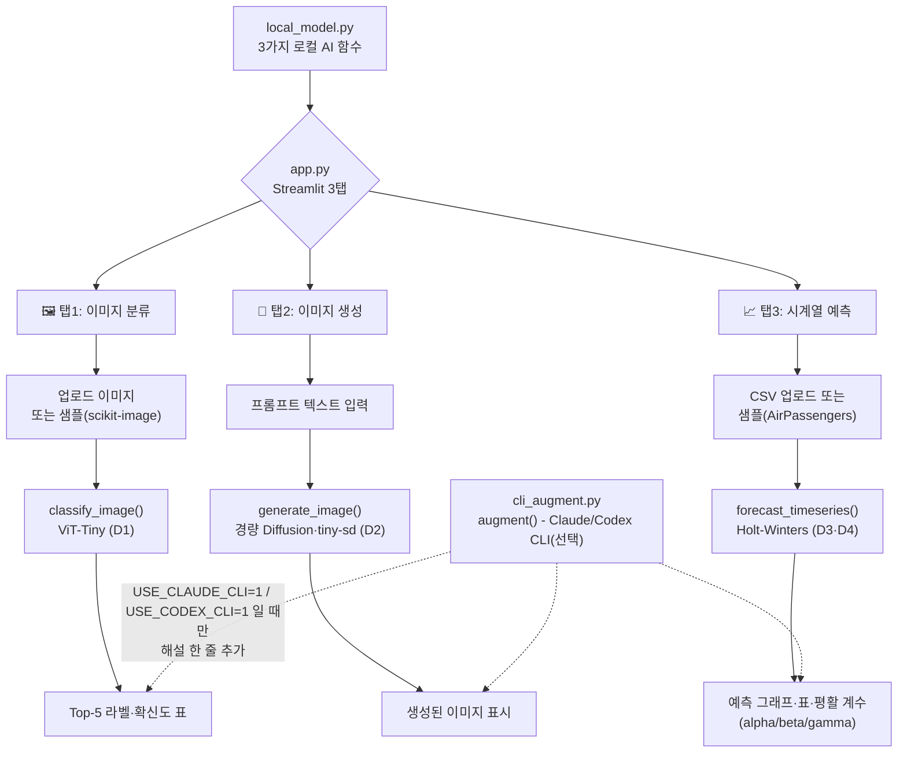

# 10주차 토요일 프로젝트 - Computer Vision·시계열 통합 분석 도구 (웹앱)

> **한 주 배운 것(ViT 이미지분류·Diffusion 이미지생성·Holt-Winters 시계열예측)** 을 **하나의 Streamlit 웹앱**으로 통합.
> **난이도:** 중상+ (여러 로컬 AI 모델을 한 화면에 통합)
> **소요:** 4시간
> **웹 UI:** Streamlit(3탭)
> **모델:** 전부 로컬(API 키 불필요) · **하이브리드 CLI 확장 포함.**

## 0. 한 줄 소개

사진을 올리면 **무엇인지 맞히고**, 글로 설명하면 **그림을 그려주고**, 과거 데이터를 올리면 **미래 숫자를 예측**해주는 앱을, 로컬 AI 모델 3개(ViT·Diffusion·Holt-Winters)를 한 화면에 모아 완성합니다. 모두 인터넷 API 키 없이 내 컴퓨터(CPU)에서 바로 동작합니다.

## 🗺 전체 흐름 (Flow-chart)



## 1. 실무 시나리오

한 스타트업의 데이터팀이 "여러 부서가 따로 쓰던 AI 도구(상품 이미지 분류, 마케팅 이미지 시안 생성, 매출 예측)를 사내 직원 누구나 쓸 수 있는 웹 도구 하나로 합쳐 달라"는 요청을 받았습니다. 각 기능은 이미 검증된 로컬 모델로 동작하되, 필요하면 Claude Code 같은 CLI 코딩 에이전트가 결과에 자연어 해설을 덧붙여주는 "선택적 확장"도 함께 마련해야 합니다. 이번 프로젝트는 그 PoC(개념 증명)를 만드는 것입니다.

## 2. 사용 데이터

- **이미지 분류**: 업로드한 사진, 또는 `scikit-image` 내장 공개 샘플(astronaut/chelsea/coffee).
- **이미지 생성**: 사용자가 직접 입력한 텍스트 프롬프트(데이터라기보다는 입력값).
- **시계열 예측**: 업로드한 CSV(날짜·값 두 열), 또는 샘플 데이터 AirPassengers(1949~1960년 월별 국제선 항공 승객 수, Box & Jenkins 1976, `statsmodels.datasets.get_rdataset` 경유, 실제 역사적 데이터). 확인일 2026-08-19.

## 3. D1~D4 연결

| Day | 이번 주 배운 것 | 프로젝트 연결 |
|---|---|---|
| D1 컴퓨터비전 기초·ViT | 이미지를 패치로 잘라 트랜스포머로 읽는 ViT, 사전학습 모델을 가져다 쓰는 흐름 | `local_model.py`의 `classify_image()` · `_load_vit()` (`WinKawaks/vit-tiny-patch16-224`) |
| D2 이미지 생성모델(Diffusion) | 디노이징 스텝(`num_inference_steps`)·경량화(지식증류) 모델 | `local_model.py`의 `generate_image()` · `_load_diffusion()` (`segmind/tiny-sd`) |
| D3 시계열 데이터·추세·계절성 | 추세/계절성/이상탐지 개념, AirPassengers 데이터 다루기 | `local_model.py`의 `load_sample_airpassengers()`, app.py 탭3의 `st.line_chart` 시각화 |
| D4 시계열 예측 실습(Holt-Winters 등) | `ExponentialSmoothing`(Holt-Winters)으로 미래 값 예측, alpha/beta/gamma 평활 계수 해석 | `local_model.py`의 `forecast_timeseries()` |

> 자세한 코드 조각 대응은 같은 폴더의 `INTEGRATION.md`를 참고하세요.

## 4. 성공 기준 ✅

- [ ] `bash env_set_up.sh` 실행이 끝까지 오류 없이 완료된다(로그 마지막에 "검증 성공: ViT-Tiny 모델 로드 완료" 문구가 보인다).
- [ ] `streamlit run app.py` 실행 시 3개 탭(이미지 분류/이미지 생성/시계열 예측)이 오류 없이 뜬다.
- [ ] **탭1**: 샘플 이미지 또는 직접 업로드한 이미지로 분류 → Top-5 예측 라벨·확신도(%) 표가 나온다.
- [ ] **탭2**: 프롬프트를 입력하고 "이미지 생성하기"를 누르면 → 이미지가 생성되어 화면에 보인다(최초 1회는 모델 다운로드로 수 분 걸릴 수 있음, 정상).
- [ ] **탭3**: 샘플(AirPassengers) 또는 CSV 업로드로 "예측 실행" → 예측 그래프·표·평활 계수(alpha/beta/gamma)가 나온다.
- [ ] **(하이브리드 아키텍처 체험)** `USE_CLAUDE_CLI=1 streamlit run app.py`로 한 번 실행해보고, 결과 화면을 캡처한다. **Claude CLI가 설치되어 있지 않다면 "🤖 Claude CLI 해설" 박스가 아예 안 보이는 게 정상입니다**(자동으로 조용히 skip됨 - `cli_augment.py`가 그렇게 설계되어 있습니다). 이 경우 "해설 박스가 안 보이는 화면"을 그대로 캡처해도 충분합니다. 즉, 성공 기준은 "해설이 떴는지"가 아니라 **"USE_CLAUDE_CLI=1을 한 번 켜서 실행해봤는지"** 입니다.

## 5. 단계별 진행 (4시간 타임박스)

| 시간 | 단계 | 무엇을 / 왜 / 어떻게 | Vibe 프롬프트 힌트 |
|---|---|---|---|
| 30분 | ① 환경 설정 | `bash env_set_up.sh` 실행(왜: venv 생성·torch 설치·모델 검증을 자동으로) → `env_set_up.log`로 결과 확인 | "env_set_up.sh가 하는 일을 4단계로 요약해줘" |
| 40분 | ② 앱 전체 훑어보기 | `source .venv/bin/activate` 후 `streamlit run app.py`, 3탭을 눈으로 먼저 확인(왜: 목표 이미지 먼저 잡기) | "app.py의 3개 탭이 각각 local_model.py의 어느 함수를 부르는지 설명해줘" |
| 40분 | ③ 탭1(이미지 분류) 뜯어보기 | `local_model.py`의 `classify_image()` · `_load_vit()` 읽기, D1 예제(`Week10_Day1_example_02_vit_batch_classify.py`)와 비교. 여러 이미지를 올려 확신도가 낮게 나오는 경우를 찾아보기 | "classify_image 함수가 ViT 모델을 어떻게 캐싱해서 재사용하는지 설명해줘" |
| 40분 | ④ 탭2(이미지 생성) 뜯어보기 | `generate_image()` 읽기, 스텝 수(steps) 슬라이더를 4~30 사이에서 바꿔가며 결과 차이 관찰(D2에서 배운 디노이징 스텝 개념 적용), 프롬프트 3개 이상 바꿔 실험 | "steps를 4로 낮췄을 때와 30으로 높였을 때 이미지 품질·속도가 왜 달라지는지 설명해줘" |
| 40분 | ⑤ 탭3(시계열 예측) 뜯어보기 | `forecast_timeseries()` 읽기, 직접 CSV(회사 매출·방문자 수 등 흉내 데이터)를 만들어 업로드해서 예측, alpha/beta/gamma 값이 뭘 의미하는지 해석 | "alpha·beta·gamma 값이 각각 크거나 작을 때 예측이 어떻게 달라지는지 설명해줘" |
| 30분(선택) | ⑥ 하이브리드 CLI 체험 | `USE_CLAUDE_CLI=1 streamlit run app.py`로 실행해보기(CLI 없으면 자동 skip, 정상) | "USE_CLAUDE_CLI 플래그가 꺼져 있을 때와 켜져 있을 때 cli_augment.py의 augment() 함수가 각각 무엇을 반환하는지 설명해줘" |
| 20분 | ⑦ 마무리·캡처 | 3탭 각각의 실행 화면을 캡처하고, `env_set_up.log`를 함께 정리 | "제출용으로 무엇을 캡처하면 좋을지 체크리스트를 만들어줘" |

## 6. 제출물

- `app.py`, `local_model.py`, `cli_augment.py` (직접 수정했다면 수정본, 안 했다면 원본 그대로도 무방)
- 3개 탭 각각의 실행 화면 캡처(분류 결과 표 / 생성된 이미지 / 예측 그래프)
- `env_set_up.log` (또는 설치가 정상적으로 끝났다는 캡처)
- (선택) `USE_CLAUDE_CLI=1`로 실행해본 화면 캡처(해설이 안 떠도 정상 - "시도해봤다"는 기록이 중요)
- 본인이 테스트에 사용한 이미지 파일 또는 CSV 파일 목록/출처 메모

## 7. FAQ

- **이미지 생성이 너무 느려요** → 최초 1회는 모델(`segmind/tiny-sd`, 약 1GB)을 내려받느라 수 분 걸릴 수 있습니다. 한 번 받아두면 이후엔 CPU에서도 256×256·10스텝 기준 약 2초 내외로 빨라집니다.
- **이미지 분류 결과가 이상해요(엉뚱한 라벨)** → `WinKawaks/vit-tiny-patch16-224`는 ImageNet의 1,000종 사물로만 학습되어 있습니다. 그 1,000종에 없는 사물(예: 특정 브랜드 로고)은 비슷한 카테고리로 잘못 분류될 수 있습니다. 확신도(%)가 낮으면 "사람 검수 필요"로 해석하세요.
- **시계열 예측에서 gamma(계절성 계수)가 0에 가깝게 나와요** → 업로드한 데이터에 뚜렷한 계절 패턴이 없다는 뜻일 수 있습니다. 데이터 특성에 따라 자연스러운 결과입니다.
- **`USE_CLAUDE_CLI=1`인데 해설 박스가 안 떠요** → 정상입니다. `claude` CLI가 설치되어 있지 않거나 로그인이 안 되어 있으면 `cli_augment.py`가 조용히 건너뜁니다(프로그램이 죽지 않습니다). 로컬 모델 결과는 항상 그대로 나옵니다.
- **앱이 아예 안 켜져요** → `bash env_set_up.sh`를 먼저 실행했는지, `source .venv/bin/activate`로 가상환경을 켰는지 확인하세요.

## 8. 더 해보기

- 이미지 분류 탭에 "확신도 60% 미만이면 검수 필요"처럼 D1 예제(`Week10_Day1_example_02_vit_batch_classify.py`)의 검수 표시 아이디어를 추가해보기.
- 이미지 생성 탭에 `guidance_scale` 슬라이더를 추가해, D2에서 배운 "프롬프트를 얼마나 강하게 따를지" 효과를 직접 비교해보기.
- 시계열 탭에 `seasonal_decompose`(D3)로 추세·계절성·잔차를 함께 그래프로 보여주는 기능 추가해보기.
- `Dockerfile`로 컨테이너 빌드까지 해보고, 깨끗한 환경에서도 앱이 동일하게 뜨는지 확인해보기.
- `USE_CODEX_CLI=1`도 켜서 Claude CLI 경로와 완전히 독립적으로 동작하는지 비교해보기.

## 파일 목록

```
project/student/
├── Week10_Project.md        ← (이 문서) 프로젝트 소개
├── INTEGRATION.md           ← D1~D4 코드와 app.py/local_model.py 연결표 + 트러블슈팅
├── 과제안내_쉬운버전.md        ← 비전공자용 아주 쉬운 안내
├── app.py                   ← Streamlit 3탭 웹앱(완성본)
├── local_model.py           ← 로컬 AI 함수 3종(완성본)
├── cli_augment.py           ← 로컬(기본) + Claude/Codex CLI(선택) 하이브리드 모듈
├── requirements.txt         ← 패키지 목록
├── env_set_up.sh            ← 환경 자동 설정 스크립트
├── Dockerfile               ← 컨테이너 배포용
└── .dockerignore
```
