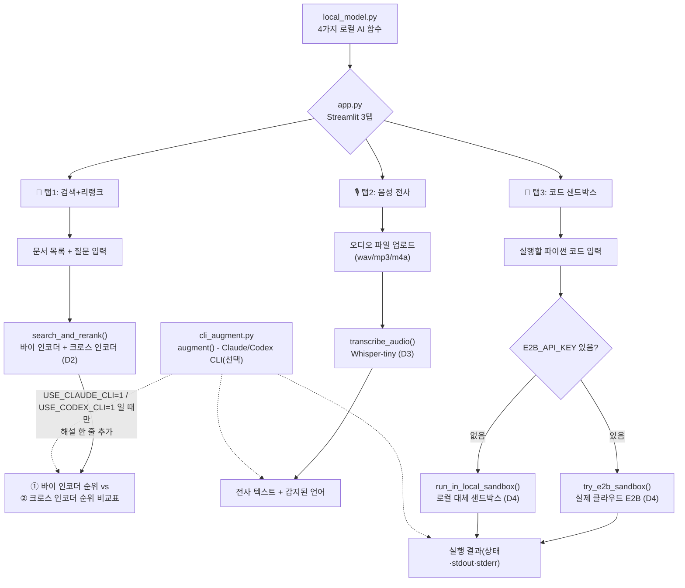

# 11주차 토요일 프로젝트 - LLM 검색·Audio·에이전트 실행환경 통합 도구 (웹앱)

> **한 주 배운 것(임베딩 검색+ReRank·Whisper 음성 전사·E2B 코드 샌드박스)** 을 **하나의 Streamlit 웹앱**으로 통합.
> **난이도:** 중상+ (여러 로컬 AI 기능을 한 화면에 통합)
> **소요:** 4시간
> **웹 UI:** Streamlit(3탭)
> **모델:** 전부 로컬(API 키 불필요) · **하이브리드 CLI 확장 포함.**

## 0. 한 줄 소개

질문을 던지면 **가장 관련 있는 문서를 찾아주고**, 음성 파일을 올리면 **글자로 받아 적어주고**, AI가 만든 코드를 **격리된 공간에서 안전하게 실행**해주는 앱을, 로컬 AI 기능 3개(임베딩 검색+리랭크·Whisper 전사·코드 샌드박스)를 한 화면에 모아 완성합니다. 모두 인터넷 API 키 없이 내 컴퓨터(CPU)에서 바로 동작합니다.

## 🗺 전체 흐름 (Flow-chart)



## 1. 실무 시나리오

한 스타트업의 데이터팀이 "여러 부서가 따로 요청하던 AI 업무(고객센터 FAQ 검색, 회의 녹음 전사, 에이전트가 만든 코드 실행)를 사내 직원 누구나 쓸 수 있는 웹 도구 하나로 합쳐 달라"는 요청을 받았습니다. 검색은 빠른 1차 후보 추리기(바이 인코더)와 정확한 재정렬(크로스 인코더)을 함께 보여줘야 하고, 회의 녹음은 로컬 Whisper로 바로 텍스트가 되어야 하며, AI 에이전트가 만든 코드는 실수로라도 회사 서버를 망가뜨리지 않도록 격리된 공간에서 실행되어야 합니다. 이번 프로젝트는 그 세 가지를 하나의 PoC(개념 증명) 웹앱으로 만드는 것입니다.

## 2. 사용 데이터

- **검색+리랭크**: 앱에 기본으로 들어있는 쇼핑몰 고객센터 FAQ 4개 문장(환불/배송/날씨/반품), 또는 직접 입력하는 문서 목록.
- **음성 전사**: 사용자가 직접 업로드하는 오디오 파일(wav/mp3/m4a/aiff), 또는 D3 예제(`Week11_Day3_example_02_tts_to_asr_roundtrip.py`)로 직접 만든 샘플 음성.
- **코드 샌드박스**: 사용자가 직접 입력하는 파이썬 코드(데이터라기보다는 입력값).

## 3. D1~D4 연결

| Day | 이번 주 배운 것 | 프로젝트 연결 |
|---|---|---|
| D1 LLM 아키텍처(토큰화·어텐션) | 문장을 토큰으로 쪼개고, 셀프 어텐션으로 서로 관련 있는 토큰을 찾는 트랜스포머의 기본 원리 | 이 프로젝트에서 직접 호출되는 함수는 없지만, D2의 임베딩 모델(`all-MiniLM-L6-v2`)·리랭커 모델이 내부적으로 D1에서 배운 토큰화·셀프 어텐션 구조로 문장을 처리합니다(개념적 기반) |
| D2 임베딩 모델과 ReRank | 바이 인코더(코사인 유사도)로 빠르게 후보를 추리고, 크로스 인코더(리랭커)로 정확하게 재정렬하는 "검색-후-재정렬" 구조 | `local_model.py`의 `search_and_rerank()`·`_load_embed_model()`·`_load_rerank_model()` (`sentence-transformers/all-MiniLM-L6-v2`, `cross-encoder/ms-marco-MiniLM-L-6-v2`) |
| D3 Audio AI(ASR·TTS·STT) | Whisper의 인코더-디코더 구조로 음성을 텍스트로 바꾸는 ASR/STT, 언어 자동 감지 | `local_model.py`의 `transcribe_audio()`·`_load_whisper()` (`openai-whisper`의 `tiny` 모델) |
| D4 E2B·코드 실행 샌드박스 | 격리(isolation)·시간 제한·짧은 생명주기(ephemeral)라는 샌드박스 3원칙, API 키 없을 때의 로컬 대체 흐름 | `local_model.py`의 `run_in_local_sandbox()`(`subprocess` + `timeout`)·`try_e2b_sandbox()`(`E2B_API_KEY` 있을 때만 시도) |

> 자세한 코드 조각 대응은 같은 폴더의 `INTEGRATION.md`를 참고하세요.

## 4. 성공 기준 ✅

- [ ] `bash env_set_up.sh` 실행이 끝까지 오류 없이 완료된다(로그 마지막에 "검증 성공: 임베딩 모델 로드 완료" 문구가 보인다).
- [ ] `streamlit run app.py` 실행 시 3개 탭(검색+리랭크/음성 전사/코드 샌드박스)이 오류 없이 뜬다.
- [ ] **탭1**: 문서 목록과 질문을 넣고 "검색 실행"을 누르면 → 바이 인코더 순위표와 크로스 인코더 순위표가 나란히 나온다.
- [ ] **탭2**: 오디오 파일을 올리고 "전사 실행"을 누르면 → 전사된 텍스트와 감지된 언어가 나온다(최초 1회는 모델 다운로드로 다소 걸릴 수 있음, 정상).
- [ ] **탭3**: 파이썬 코드를 입력하고 "코드 실행"을 누르면 → 실행 상태(완료/시간초과/오류)와 결과(stdout/stderr)가 나온다.
- [ ] **(하이브리드 아키텍처 체험)** `USE_CLAUDE_CLI=1 streamlit run app.py`로 한 번 실행해보고, 결과 화면을 캡처한다. **Claude CLI가 설치되어 있지 않다면 "🤖 Claude CLI 해설" 박스가 아예 안 보이는 게 정상입니다**(자동으로 조용히 skip됨 - `cli_augment.py`가 그렇게 설계되어 있습니다). 이 경우 "해설 박스가 안 보이는 화면"을 그대로 캡처해도 충분합니다. 즉, 성공 기준은 "해설이 떴는지"가 아니라 **"USE_CLAUDE_CLI=1을 한 번 켜서 실행해봤는지"** 입니다.

## 5. 단계별 진행 (4시간 타임박스)

| 시간 | 단계 | 무엇을 / 왜 / 어떻게 | Vibe 프롬프트 힌트 |
|---|---|---|---|
| 30분 | **① 환경 설정** | `bash env_set_up.sh` 실행(왜: venv 생성·torch 설치·ffmpeg 확인·모델 검증을 자동으로) → `env_set_up.log`로 결과 확인 | "env_set_up.sh가 하는 일을 5단계로 요약해줘" |
| 40분 | **② 앱 전체 훑어보기** | `source .venv/bin/activate` 후 `streamlit run app.py`, 3탭을 눈으로 먼저 확인(왜: 목표 이미지 먼저 잡기) | "app.py의 3개 탭이 각각 local_model.py의 어느 함수를 부르는지 설명해줘" |
| 40분 | **③ 탭1(검색+리랭크) 뜯어보기** | `local_model.py`의 `search_and_rerank()` 읽기, D2 예제(`Week11_Day2_example_02_rerank_compare.py`)와 비교. 문서 목록을 늘리거나 질문을 바꿔가며 바이 인코더 1위와 크로스 인코더 1위가 갈리는 경우를 찾아보기 | "바이 인코더 1위와 크로스 인코더 1위가 다를 때, 어느 쪽이 더 신뢰할 만한지 설명해줘" |
| 40분 | **④ 탭2(음성 전사) 뜯어보기** | `transcribe_audio()` 읽기, D3 예제(`Week11_Day3_example_02_tts_to_asr_roundtrip.py`)로 샘플 음성을 직접 만들어 업로드해보기, 한국어/영어 오디오를 각각 넣어 언어 감지가 잘 되는지 관찰 | "Whisper-tiny 모델이 감지된 언어를 어떻게 판단하는지 설명해줘" |
| 40분 | **⑤ 탭3(코드 샌드박스) 뜯어보기** | `run_in_local_sandbox()`·`try_e2b_sandbox()` 읽기, 무한루프 코드(`while True: pass`)를 넣어 시간 제한이 실제로 작동하는지 확인, `E2B_API_KEY` 없이도 앱이 자연스럽게 로컬 샌드박스로 넘어가는지 확인 | "E2B_API_KEY가 없을 때 코드가 어떤 순서로 로컬 샌드박스로 넘어가는지 설명해줘" |
| 30분(선택) | **⑥ 하이브리드 CLI 체험** | `USE_CLAUDE_CLI=1 streamlit run app.py`로 실행해 보기(CLI 없으면 자동 skip, 정상) | "USE_CLAUDE_CLI 플래그가 꺼져 있을 때와 켜져 있을 때 cli_augment.py의 augment() 함수가 각각 무엇을 반환하는지 설명해줘" |
| 20분 | **⑦ 마무리·캡처** | 3탭 각각의 실행 화면을 캡처하고, `env_set_up.log`를 함께 정리 | "제출용으로 무엇을 캡처하면 좋을지 체크리스트를 만들어줘" |

## 6. 제출물

- `app.py`, `local_model.py`, `cli_augment.py` (직접 수정했다면 수정본, 안 했다면 원본 그대로도 무방)
- 3개 탭 각각의 실행 화면 캡처(검색+리랭크 비교표 / 전사 결과 / 코드 실행 결과)
- `env_set_up.log` (또는 설치가 정상적으로 끝났다는 캡처)
- (선택) `USE_CLAUDE_CLI=1`로 실행해본 화면 캡처(해설이 안 떠도 정상 - "시도해봤다"는 기록이 중요)
- 본인이 테스트에 사용한 오디오 파일 또는 문서 목록 메모

## 7. FAQ

- **음성 전사 탭에서 오류가 나요** → 시스템에 `ffmpeg`가 설치되어 있는지 확인하세요(`ffmpeg -version`). macOS는 `brew install ffmpeg`, Ubuntu/Docker는 `apt-get install -y ffmpeg`로 설치할 수 있습니다. `env_set_up.sh`가 4단계에서 자동으로 확인해줍니다.
- **검색+리랭크 결과가 이상해요(두 순위가 항상 똑같아요)** → 문서 개수가 너무 적거나(2개 이하) 문서들이 서로 너무 비슷하면 두 방식의 순위가 같게 나올 수 있습니다. 문서를 4개 이상, 서로 다른 주제로 늘려서 비교해보세요.
- **코드 샌드박스에서 `E2B_API_KEY`가 없는데 계속 로컬로만 실행돼요** → 정상입니다. `try_e2b_sandbox()`는 `E2B_API_KEY` 환경변수가 없으면 즉시 `None`을 반환하도록 설계되어 있고, `app.py`가 그 경우 자동으로 `run_in_local_sandbox()`로 넘어갑니다(화면에도 "로컬 대체 샌드박스를 사용했습니다" 안내가 뜹니다).
- **`USE_CLAUDE_CLI=1`인데 해설 박스가 안 떠요** → 정상입니다. `claude` CLI가 설치되어 있지 않거나 로그인이 안 되어 있으면 `cli_augment.py`가 조용히 건너뜁니다(프로그램이 죽지 않습니다). 로컬 모델 결과는 항상 그대로 나옵니다.
- **앱이 아예 안 켜져요** → `bash env_set_up.sh`를 먼저 실행했는지, `source .venv/bin/activate`로 가상환경을 켰는지 확인하세요.

## 8. 더 해보기

- 탭1에 top_k 슬라이더를 추가해, 문서가 많을 때 상위 몇 개만 보여줄지 사용자가 직접 조절해보기.
- 탭2에 D3 교안의 "전문용어 힌트를 미리 알려주면 어떻게 될까" 아이디어(`initial_prompt`)를 추가해, 특정 용어의 인식률이 달라지는지 실험해보기.
- 탭3에 D4 예제(`Week11_Day4_example_02_local_sandbox_demo.py`)의 "위험한 내장함수 제한(`SAFE_BUILTINS`)" 아이디어를 추가해, `open()`처럼 파일에 접근하려는 코드가 차단되는지 확인해보기(단, 교육용 개념 예시로서 진짜 보안 경계는 아니라는 점을 함께 적어보기).
- `Dockerfile`로 컨테이너 빌드까지 해보고, 깨끗한 환경에서도 앱이 동일하게 뜨는지 확인해보기(ffmpeg가 컨테이너 안에도 설치되어 있는지 특히 확인).
- `USE_CODEX_CLI=1`도 켜서 Claude CLI 경로와 완전히 독립적으로 동작하는지 비교해보기.

## 파일 목록

```
project/student/
├── Week11_Project.md        ← (이 문서) 프로젝트 소개
├── INTEGRATION.md           ← D1~D4 코드와 app.py/local_model.py 연결표 + 트러블슈팅
├── 과제안내_쉬운버전.md        ← 비전공자용 아주 쉬운 안내
├── app.py                   ← Streamlit 3탭 웹앱(완성본)
├── local_model.py           ← 로컬 AI 함수 4종(완성본)
├── cli_augment.py           ← 로컬(기본) + Claude/Codex CLI(선택) 하이브리드 모듈
├── requirements.txt         ← 패키지 목록
├── env_set_up.sh            ← 환경 자동 설정 스크립트
├── Dockerfile               ← 컨테이너 배포용
└── .dockerignore
```
