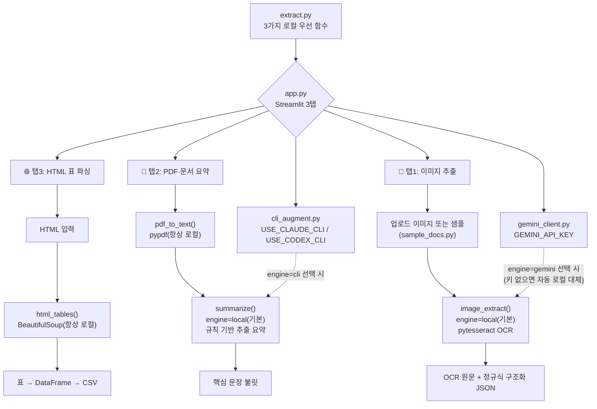

# 12주차 토요일 프로젝트 - 문서·이미지 정보 추출기 📄

> **로컬 OCR·규칙 기반 요약으로 이미지·PDF·HTML에서 정보를 뽑아 정리하는 웹앱.** 기본값은 항상 "로컬"이라 키·인터넷 없이 100% 동작하고, 필요할 때만 CLI 다듬기·Gemini로 확장합니다.
> **난이도:** 중 · **웹 UI:** Streamlit(3탭) · **핵심 로컬 모델:** Tesseract OCR(pytesseract) · **컨테이너 검증 완료.**

## 0. 한 줄 소개

영수증 이미지 → 로컬 OCR로 실제 글자 인식 → JSON, PDF → 로컬 규칙 기반 요약, HTML 표 → 데이터프레임. 흩어진 문서를 구조화 데이터로.

## 🗺 전체 흐름 (Flow-chart)



## 1. 왜 "로컬이 기본"인가

멀티모달 클라우드 AI(Gemini 등)로 이미지를 읽는 방법도 있지만, 이번 프로젝트는 **인터넷·API 키 없이도 100% 동작**하는 것을 우선순위로 둡니다. 그래서:

- 🧾 이미지 추출의 기본 경로는 **Tesseract OCR**(`pytesseract`)입니다. 실제로 이미지 속 글자를 픽셀 단위로 인식합니다(가짜 응답이 아닙니다).
- 📄 PDF/이미지 요약의 기본 경로는 **규칙 기반 추출 요약**(문장 점수를 매겨 핵심 문장만 고르는 방식)입니다. 외부 API 호출이 없습니다.
- 필요하면 각 탭에서 **CLI 다듬기**(Claude/Codex CLI, `cli_augment.py`) 또는 **Gemini**(`gemini_client.py`, `GEMINI_API_KEY` 필요)로 전환할 수 있습니다. 이 두 경로는 "선택 사항"이며, 실패해도 로컬 결과로 조용히 대체됩니다.

## 2. 화면(3탭)

- **🧾 이미지 추출** - 영수증·표 이미지 → pytesseract OCR로 실제 글자 인식 → 정규식으로 항목·수량·금액 JSON 구조화(기본, 로컬). Gemini 멀티모달은 선택.
- **📄 PDF·문서 요약** - PDF 텍스트 추출(pypdf) → 로컬 규칙 기반 요약(기본). CLI 다듬기·Gemini는 선택.
- **🌐 HTML 표 파싱** - 웹 표(BeautifulSoup) → 표 정리 + CSV(항상 로컬).

## 3. D1~D4 연결

| Day | 프로젝트 |
|---|---|
| D1 컴퓨터 비전·멀티모달 | 이미지에서 정보를 읽어내는 개념 → 이번엔 OCR로 직접 구현 |
| D2 AI Studio 이미지 추출 | 🧾 이미지 탭(선택 경로로 Gemini 유지) |
| D3 PDF 파싱·요약 | 📄 PDF 탭 |
| D4 HTML 파싱·리포트 | 🌐 HTML 탭 |

## 4. 성공 기준 ✅

- [ ] `bash env_set_up.sh` 실행이 끝까지 오류 없이 완료된다(로그에 Tesseract 확인·OCR 검증 문구가 남는다).
- [ ] `streamlit run app.py` 오류 없이 뜬다(3탭).
- [ ] 이미지 탭: 샘플/업로드 이미지에서 **실제 OCR 텍스트**와 구조화 JSON이 나온다.
- [ ] PDF 탭: 텍스트 추출 + **로컬 요약**(불릿)이 나온다.
- [ ] HTML 탭: 표가 데이터프레임/CSV로 나온다.
- [ ] (선택) 각 탭의 엔진을 `cli`/`gemini`로 바꿔보고, 로컬과 무엇이 다른지 비교해본다.

## 5. 실행

```bash
cd project/student
bash env_set_up.sh          # 최초 1회: venv 생성 + 패키지 설치 + Tesseract 확인 + OCR 검증
source .venv/bin/activate
streamlit run app.py
```

## 6. 제출물

`app.py`(수정본), 3탭 화면 캡처(특히 이미지 탭의 OCR 원문), `env_set_up.log`, 추출 결과 CSV/JSON, 데이터 출처 메모.

## 7. 더 해보기

- 여러 이미지를 일괄 OCR해 표로 모으기, `_parse_receipt_lines()`의 정규식을 실제 영수증 형식에 맞게 확장하기.
- `engine="cli"`로 `USE_CLAUDE_CLI=1`을 켜서 요약이 얼마나 매끄러워지는지 비교하기.
- 추출 결과를 9주차 대시보드로 연결.
- `Dockerfile`로 빌드해, 시스템에 Tesseract가 없는 깨끗한 컨테이너에서도 `apt-get install -y tesseract-ocr` 덕분에 OCR이 동작하는지 확인.

## 파일

```
project/student/
├── Week12_Project.md        ← (이 문서) 프로젝트 소개
├── INTEGRATION.md           ← 연동 가이드 + 트러블슈팅
├── 과제안내_쉬운버전.md      ← 비전공자용 아주 쉬운 안내
├── app.py                   ← Streamlit 3탭 웹앱
├── extract.py               ← 로컬 OCR·로컬 요약(기본) + CLI/Gemini(선택) 핵심 로직
├── gemini_client.py         ← Gemini 공용 호출기(선택 경로, mock 폴백 포함)
├── cli_augment.py           ← 로컬(기본) + Claude/Codex CLI(선택) 하이브리드 모듈
├── sample_docs.py           ← 샘플 HTML/영수증 이미지(OCR 친화적으로 렌더링)
├── sample_invoice.pdf       ← 샘플 PDF
├── requirements.txt         ← 패키지 목록(pytesseract 포함)
├── env_set_up.sh            ← 환경 자동 설정 + Tesseract 확인 + OCR 검증 스크립트
├── run.sh                   ← 빠른 실행 스크립트
├── Dockerfile               ← 컨테이너 배포용(tesseract-ocr apt 설치 포함)
├── .dockerignore
└── examples/(01_html_table, 02_pdf_and_image)
```
