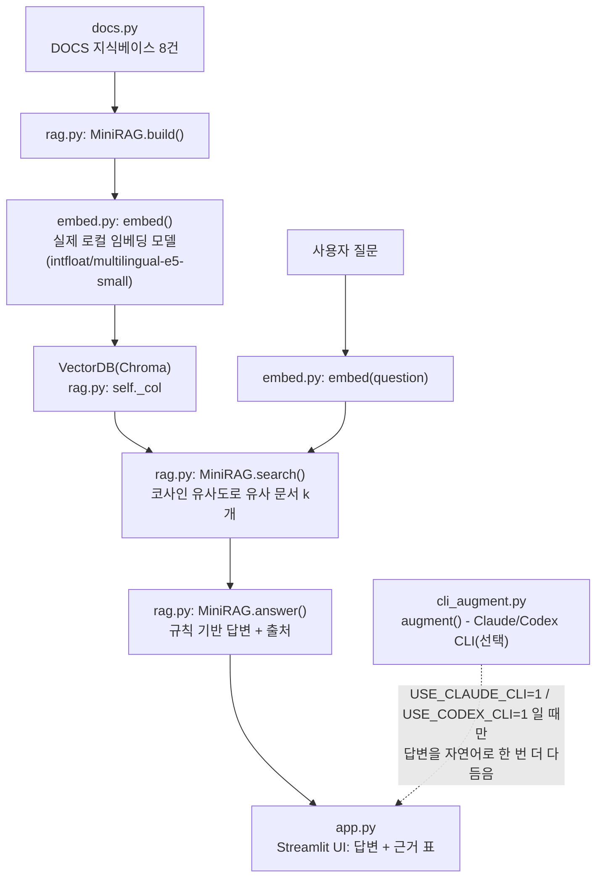

# 13주차 토요일 프로젝트 - 미니 RAG 문서 Q&A 🔎

> **문서를 실제 로컬 임베딩 모델로 벡터화해 VectorDB(Chroma)에 넣고, 질문과 비슷한 문서를 찾아 '출처와 함께' 답하는 웹앱.** API 키 불필요.
> **난이도:** 중 · **소요:** 3~4시간 · **웹 UI:** Streamlit · **VectorDB:** Chroma(로컬) · **임베딩:** 실제 로컬 모델(mock 아님) · **하이브리드 CLI 확장 포함.**

## 0. 한 줄 소개

사내 FAQ 8개를 지식베이스로 삼아, 질문을 하면 **의미가 가장 비슷한 문서**를 실제 임베딩 모델로 찾아내 근거와 함께 답합니다. 예전 버전은 글자 겹침만 세는 "흉내 임베딩"이었지만, 이번 버전은 진짜 사전학습 임베딩 모델을 로컬(CPU)에서 돌립니다.

## 🗺 전체 흐름 (Flow-chart)



## 1. 실무 시나리오

한 이커머스 회사의 CS팀이 "반복되는 FAQ 문의를 상담원 대신 1차로 응대해 줄 사내 검색 챗봇을 만들어 달라"는 요청을 받았습니다. 정답을 LLM이 마음대로 지어내면(환각) 회사가 책임질 수 없는 안내를 하게 되므로, **반드시 실제 사내 문서에서 근거를 찾아 그 문서를 그대로 보여주는 방식**(RAG)으로 설계해야 합니다. 이번 프로젝트는 그 최소 기능 제품(MVP)을 만드는 것입니다.

## 2. 사용 데이터

- `docs.py`의 `DOCS`: 반품정책·배송기간·교환방법·포인트적립·환불처리·회원등급·쿠폰사용·고객센터 8개 항목으로 구성한 사내 FAQ 예시 데이터(이 프로젝트를 위해 직접 작성한 샘플 데이터이며, 실제 회사 문서가 아닙니다).
- 실제 서비스에 적용한다면 사내 위키·매뉴얼 PDF 등을 `docs.py`의 `DOCS` 형식(제목, 본문)으로 바꿔 넣으면 됩니다(§8 "더 해보기" 참고).

## 3. D1~D4 연결

| Day | 이번 주 배운 것 | 프로젝트 연결 |
|---|---|---|
| D1 LLM 한계·RAG 배경 (`Week13_Day1_LLM한계와_RAG배경.md`) | 일반 LLM은 근거 없이 "아마도"로 답해 환각 위험이 있다는 것, RAG가 왜 필요한지 | `rag.py`의 `MiniRAG.answer()` - 항상 검색된 문서(근거)를 함께 반환해 환각을 줄인다 |
| D2 임베딩·코사인 유사도 (`Week13_Day2_임베딩과_코사인유사도.md`) | 문장을 벡터로 바꾸고(임베딩), 두 벡터가 얼마나 비슷한지 코사인 유사도로 재는 법 | `embed.py`의 `embed()`·`cosine()` - 실제 로컬 임베딩 모델로 구현 |
| D3 VectorDB 실습(Chroma) (`Week13_Day3_VectorDB실습_Chroma.md`) | 임베딩 벡터를 저장하고 빠르게 유사 검색하는 VectorDB(Chroma)의 기본 사용법 | `rag.py`의 `MiniRAG.__init__()`(컬렉션 생성)·`add()`(색인)·`search()`(검색) |
| D4 청킹·출처 기반 답변 (`Week13_Day4_청킹과_출처기반답변.md`) | 긴 문서를 작은 조각(청크)으로 나누는 법, 답변에 항상 출처를 함께 보여주는 설계 | `docs.py`의 `chunk()`, `rag.py`의 `answer()`가 근거 목록(`hits`)을 함께 반환 |

> 자세한 코드 조각 대응은 같은 폴더의 `INTEGRATION.md`를 참고하세요.

## 4. 성공 기준 ✅

- [ ] `bash env_set_up.sh` 실행이 끝까지 오류 없이 완료된다(로그 마지막에 "검증 성공: 임베딩 모델 로드 완료" 문구가 보인다).
- [ ] `python3 embed.py`를 실행하면 실제 임베딩 벡터(384차원)가 출력된다(0과 1로만 이뤄진 해시 벡터가 아니라 소수점 실수 벡터).
- [ ] `python3 rag.py`를 실행하면 "반품하고 싶어요" 질문에 **반품정책 문서가 근거 1위**로 나온다(예전 해시 mock은 키워드가 겹쳐야만 맞혔지만, 지금은 "돈을 다시 돌려받고 싶어요"처럼 키워드가 겹치지 않는 질문도 잘 찾습니다 - INTEGRATION.md의 실측 비교 참고).
- [ ] `streamlit run app.py` 오류 없이 뜬다.
- [ ] 질문 → 관련 문서 검색 → **답변 + 출처(근거)** 표시. 근거 문서 수(k)를 바꿀 수 있다.
- [ ] **(하이브리드 아키텍처 체험)** `USE_CLAUDE_CLI=1 streamlit run app.py`로 한 번 실행해보고, 결과 화면을 캡처한다. **Claude CLI가 설치되어 있지 않다면 "🤖 Claude CLI가 다듬은 답변" 박스가 아예 안 보이는 게 정상입니다**(자동으로 조용히 skip됨). 이 경우 "박스가 안 보이는 화면"을 그대로 캡처해도 충분합니다. 성공 기준은 "해설이 떴는지"가 아니라 **"USE_CLAUDE_CLI=1을 한 번 켜서 실행해봤는지"** 입니다.

## 5. 단계별 진행 (3~4시간 타임박스)

| 시간 | 단계 | 무엇을 / 왜 / 어떻게 | Vibe 프롬프트 힌트 |
|---|---|---|---|
| 30분 | ① 환경 설정 | `bash env_set_up.sh` 실행(왜: venv 생성·패키지 설치·임베딩 모델 검증을 자동으로) → `env_set_up.log`로 결과 확인 | "env_set_up.sh가 하는 일을 3단계로 요약해줘" |
| 30분 | ② embed.py 뜯어보기 | `python3 embed.py` 실행 → 실제 벡터가 나오는지 확인, D2 교안과 비교하며 `_load_model()`이 왜 전역 캐시를 쓰는지 이해 | "embed.py가 예전 해시 버전과 무엇이 다른지 설명해줘" |
| 40분 | ③ rag.py 뜯어보기 | `python3 rag.py` 실행 → 색인·검색·답변 흐름 확인, `MiniRAG.search()`가 Chroma가 있을 때/없을 때 어떻게 다르게 동작하는지 코드로 확인 | "Chroma가 설치 안 되어 있으면 rag.py가 어떻게 대체 동작하는지 설명해줘" |
| 40분 | ④ 앱 실행·질문 실험 | `streamlit run app.py`로 앱을 켜고, 키워드가 겹치지 않는 질문(예: "돈을 다시 돌려받고 싶어요")도 넣어보며 검색 품질을 직접 체감 | "이 질문에 왜 이 문서가 근거로 나왔는지 유사도 점수로 설명해줘" |
| 30분(선택) | ⑤ 하이브리드 CLI 체험 | `USE_CLAUDE_CLI=1 streamlit run app.py`로 실행해 보기(CLI 없으면 자동 skip, 정상) | "USE_CLAUDE_CLI 플래그가 꺼져 있을 때와 켜져 있을 때 app.py가 각각 무엇을 보여주는지 설명해줘" |
| 30분 | ⑥ 내 지식베이스로 바꿔보기(선택) | `docs.py`의 `DOCS`를 내가 아는 주제(회사 규정, 동아리 안내 등) 5~8개로 바꿔 다시 실행 | "DOCS 리스트 형식에 맞춰 새 항목 3개만 추가해줘" |
| 20분 | ⑦ 마무리·캡처 | 검색 결과 화면을 캡처하고, `env_set_up.log`를 함께 정리 | "제출용으로 무엇을 캡처하면 좋을지 체크리스트를 만들어줘" |

## 6. 제출물

- `app.py`, `rag.py`, `embed.py`, `docs.py`(직접 수정했다면 수정본, 안 했다면 원본 그대로도 무방)
- 질의응답 화면 캡처(질문 입력 → 답변 + 출처 표시)
- `env_set_up.log`(또는 설치가 정상적으로 끝났다는 캡처)
- (선택) `USE_CLAUDE_CLI=1`로 실행해본 화면 캡처(해설이 안 떠도 정상 - "시도해봤다"는 기록이 중요)
- 지식베이스(문서) 출처 메모: `docs.py`를 그대로 썼다면 "샘플 FAQ 그대로 사용"이라고, 바꿨다면 어디서 가져온 내용인지 메모

## 7. FAQ

- **왜 `sentence-transformers/all-MiniLM-L6-v2`가 아니라 `intfloat/multilingual-e5-small`을 쓰나요?** → all-MiniLM-L6-v2는 영어 코퍼스로 학습된 모델이라 한국어 문장을 실제로는 잘 이해하지 못합니다. `docs.py`의 한국어 FAQ로 질문 12개를 직접 측정해 보니 all-MiniLM-L6-v2는 정답 문서를 1위로 찾은 게 4/12였고, "배송 얼마나 걸려요?"라는 질문에 정작 "배송기간" 문서가 8개 중 꼴찌(8위)로 나오는 등 예전 해시 mock(8/12)보다도 결과가 나빴습니다. 반면 다국어를 지원하는 `multilingual-e5-small`은 같은 테스트에서 11/12를 1위로 찾았습니다(벡터 차원도 384로 같음). 그래서 이 모델을 최종 선택했습니다. 자세한 실측 로그는 `INTEGRATION.md`를 참고하세요.
- **`python3 embed.py`가 처음에 오래 걸려요** → 최초 1회는 모델(약 450MB)을 내려받느라 시간이 걸릴 수 있습니다. 한 번 받아두면(`~/.cache/huggingface`) 이후엔 몇 초 안에 로드됩니다.
- **`chromadb`가 설치되어 있지 않아요** → 걱정하지 마세요. `rag.py`가 자동으로 감지해서 순수 파이썬 코사인 유사도 검색으로 대체합니다(실습은 그대로 계속됩니다).
- **`USE_CLAUDE_CLI=1`인데 해설 박스가 안 떠요** → 정상입니다. `claude` CLI가 설치되어 있지 않거나 로그인이 안 되어 있으면 `cli_augment.py`가 조용히 건너뜁니다(프로그램이 죽지 않습니다). 규칙 기반 답변과 출처는 항상 그대로 나옵니다.
- **검색이 가끔 엉뚱한 문서를 1위로 찾아요** → 실제 임베딩 모델도 완벽하지 않습니다. 짧고 애매한 질문일수록 오답 가능성이 있습니다. `k`(근거 문서 수)를 늘려 2~3위 안에 정답이 있는지 함께 살펴보는 것도 좋은 습관입니다.

## 8. 더 해보기

- 내 문서로 지식베이스(`docs.py`의 `DOCS`) 교체해보기.
- `USE_CODEX_CLI=1`도 켜서 Claude CLI 경로와 완전히 독립적으로 동작하는지 비교해보기.
- `docs.py`의 `chunk()`를 활용해 더 긴 문서를 여러 조각으로 나눠 색인해보기(청킹 실습).
- 14-1주차에서 배울 검색 API와 결합해, 사내 문서뿐 아니라 웹 검색 결과도 근거로 활용하는 확장 아이디어 구상해보기.
- `Dockerfile`로 컨테이너 빌드까지 해보고, 깨끗한 환경에서도 앱이 동일하게 뜨는지 확인해보기.

## 파일 목록

```
project/student/
├── Week13_Project.md       ← (이 문서) 프로젝트 소개
├── INTEGRATION.md          ← D1~D4 코드와 app.py/rag.py/embed.py 연결표 + 실측 비교 + 트러블슈팅
├── 과제안내_쉬운버전.md      ← 비전공자용 아주 쉬운 안내
├── app.py                  ← Streamlit 웹앱(완성본, 하이브리드 CLI 확장 포함)
├── rag.py                  ← 미니 RAG(색인·검색·답변, Chroma)
├── embed.py                ← 실제 로컬 임베딩 모델(intfloat/multilingual-e5-small)
├── docs.py                 ← 지식베이스(샘플 FAQ 8개) + chunk()
├── cli_augment.py          ← 로컬(기본) + Claude/Codex CLI(선택) 하이브리드 모듈
├── requirements.txt        ← 패키지 목록
├── run.sh                  ← 빠른 실행 스크립트
├── env_set_up.sh           ← 환경 자동 설정 스크립트
├── Dockerfile              ← 컨테이너 배포용
├── .dockerignore
└── examples/
    ├── example_01_embed_similarity.py
    └── example_02_rag_search.py
```
